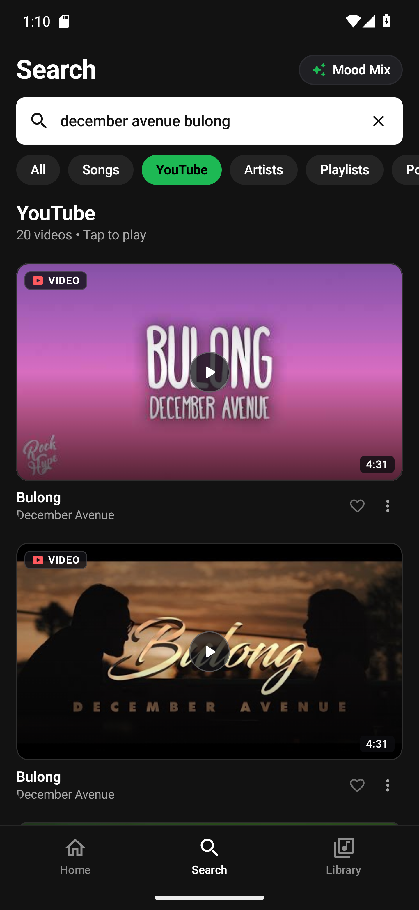
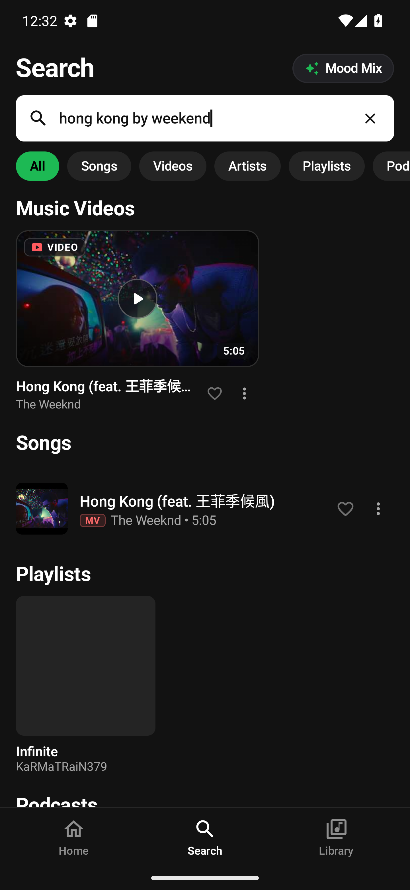
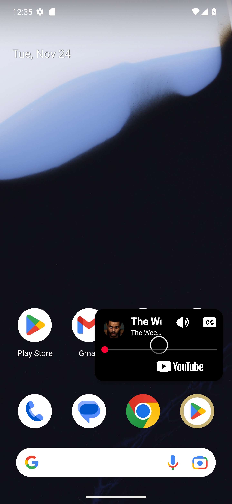

# Sonora

**Sonora** (`com.sonora.music`) is a free, zero-login Android **Spotify + YouTube Music Hybrid** app built with Kotlin, Jetpack Compose, Media3 ExoPlayer, and the official YouTube IFrame Player API in a clean matte charcoal design.

No account, no signup, no ads — stream **100% full-length songs** from start to finish (zero 30-second previews anywhere across `All`, `PH Hits`, `OPM`, `Global`, `YouTube`, Search, Playlists, and Downloads), search **live YouTube** directly from the Search bar or Home's `YouTube` tab for any song, artist, or music video with zero manual import needed, keep playback going in the background via docked MiniPlayer video, Android **Picture-in-Picture (PiP)**, or hybrid ExoPlayer audio handoff, control playback from the **Android 13–15 notification panel & lock screen**, explore **Philippines (PH)** & **Global** hits (strictly filtering out Indian/Bollywood catalog tracks via `RegionalContentFilter`), listen to live PH radio & podcasts, download offline full-length MP3s, follow synced lyrics, and tune audio with a 5-band hardware equalizer.

> **Latest Release APK (`v4.2`)**: [Sonora-v4.2.apk on Google Drive](https://drive.google.com/file/d/18F_FvsWwFozQVejlguZnECSd5GmW-50e/view?usp=drivesdk)

---

## App Preview (v4.2 & v4.1)

<table>
  <tr>
    <td align="center"><br /><sub><b>v4.2 Live YouTube Search: Any Song or Artist (Bulong)</b></sub></td>
    <td align="center"><br /><sub><b>Direct Search: Hong Kong (The Weeknd) — No Import Needed</b></sub></td>
    <td align="center"><br /><sub><b>Background Picture-in-Picture on Home Screen</b></sub></td>
    <td align="center"><br /><sub><b>Song / Video Switcher &amp; Wish 107.5 MV</b></sub></td>
  </tr>
</table>

---

## Key Features (v4.2)

- **Live YouTube Search Bar & Instant Playback (Zero Import Required)**
  - **Search Any Song or Artist Live on YouTube**: `YouTubeCatalogApi` now queries YouTube live (`youtubei/v1/search` with HTML `ytInitialData` fallback) right inside the Search bar (`Search songs, artists, or YouTube...` / `YouTube` tab) as well as the dedicated **"Search any song or video on YouTube..."** bar on Home's `YouTube` filter tab — finding songs beyond the 39 curated official channels (e.g., *December Avenue — Bulong*) while automatically skipping Shorts (<45s previews) and filtering out excluded Indian/Bollywood content.
  - **Search & Tap to Play Immediately**: Top curated MVs (e.g., *Hong Kong (feat. 王菲季候風)* by **The Weeknd** / `"hong kong by weekend"`, *Esremborak*, *Mariah Deborah*) plus live YouTube results appear directly in Search for one-tap playback with zero manual import or downloading.
  - **Smart Ranking & Query Aliasing**: `SonoraViewModel.executeSearch` prioritizes verified/direct-play YouTube MV matches at the top of both `All` and `Songs`, while `MusicCatalogApi` & `YouTubeCatalogApi` normalize natural queries like `"hong kong by weekend"`, `"ben and ben"`, `"cup of jo"`, `"esremborac"`, and `"maria deborah"`.
  - **`[ Song | Video ]` Segmented Switcher** in `FullPlayerSheet` on hybrid tracks powered by the official YouTube IFrame Player API (`YouTubeVideoPlayer`), with explicit origin/referrer policy and external YouTube fallback if a rights-holder blocks embedded playback.
- **Background Playback & Android Picture-in-Picture (PiP)**
  - **Single Persistent Hoisted Player (`SonoraApp`)**: One live `YouTubeVideoPlayer` moves seamlessly between `FullPlayerSheet` and the 96×54dp live-video `MiniPlayer` without reloading when you minimize the sheet.
  - **Android Picture-in-Picture**: Pressing Home or switching apps while watching enters a floating 16:9 PiP window (`MainActivity` `PictureInPictureParams` with Play/Pause, Previous, and Next `RemoteAction` controls), alongside a manual **PiP** chip in `FullPlayerSheet`.
  - **Hybrid Audio Handoff**: When the app stops outside PiP (e.g., screen lock), hybrid tracks with full-length audio hand off seamlessly to `ExoPlayer` (`PlaybackController.resumeAudioFromVideoPosition`) so music continues uninterrupted.
- **Unified Android 13–15 Notification & Lock-Screen Media Controls**
  - **`SonoraPlaybackService` & `YouTubeMirrorPlayer`**: Mirrors active YouTube playback (`YouTubePlaybackBridge`, artwork thumbnail via `SonoraBitmapLoader`, title, artist, queue controls) into Android's `Media3` `MediaSession` & `sonora_media_playback` notification channel, providing Previous, Play/Pause, Next, and seekbar controls in the notification shade and lock screen for both audio and video playback.
- **100% Full-Length PH & Global Playback (Zero 30-Second Previews)**
  - **Zero Legacy Previews**: `FullAudioResolver`, `MusicCatalogApi`, `SonoraStore`, `RecommendationEngine`, and `DownloadManager` strip all `isPreviewOnly` and 30s preview hosts (`cdns-preview`, `cdnt-preview`, `dzcdn.net`, `audio-ssl.itunes`) end-to-end.
  - **Strict Anti-Indian Content Filter (`RegionalContentFilter`)**: Excludes Indian/Hindi/Bollywood/Punjabi/Tamil/Telugu/Malayalam/Kannada/Marathi/Bengali/Bhojpuri/Gujarati/Desi tracks, artists, and labels across Audius results, catalog shelves, search, recommendations, and live YouTube RSS feeds.
  - **Discovery & Media**: **Deezer & Apple Music PH Charts** (discovery/artwork only), **Audius Open Catalog**, **LRCLIB** synced lyrics, **Radio Browser PH**, **iTunes PH Podcasts**, **Internet Archive LibriVox Audiobooks**, and **Device Local Audio (`MediaStore`)**.
- **Playlists, Collaborative Sharing & Offline Downloads**
  - Create, rename, color-theme, reorder, export/import collaborative share codes (`SONORA-PL-V1:` / `sonora://playlist`), merge into a **Jam Queue**, generate prompt-based **Mood Mixes**, and download full-length MP3s for offline listening.
- **Audio Studio & Player Tools**
  - **5-Band Hardware Equalizer**, **Bass Boost**, **Spatial Virtualizer**, **Crossfade** (`0s`–`12s`), **Playback Speed** (`0.75x`–`2.0x`), **Sleep Timer** (`5m`–`60m` or End of Track), **Smart Shuffle**, **Track/Artist Radio**, **Private Session**, and **Wrapped Listening Stats**.

---

## Device Compatibility (Including Samsung Galaxy S21+)

- **Version**: `versionCode = 8`, `versionName = "4.2"`
- **APK File**: `Sonora-v4.2.apk` (`3,944,362` bytes, APK Signature Scheme v2)
- **Android Version**: `minSdk = 26` (Android 8.0+) through `targetSdk = 35` (Android 15 / Samsung One UI 3.1 – One UI 7, including One UI themed monochrome icon, Picture-in-Picture, and hardware-accelerated WebView)
- **CPU ABIs**: `arm64-v8a` (64-bit ARM for Galaxy S21+ Exynos 2100 / Snapdragon 888), `armeabi-v7a`, `x86`, `x86_64`
- **Signing & Display**: APK Signature Scheme v2 release build with edge-to-edge safe insets for punch-hole displays and gesture navigation bars.

---

## Build & Test

Set `JAVA_HOME` (JDK 17+) and `ANDROID_HOME` (or configure `sdk.dir` in `local.properties`):

```powershell
$env:JAVA_HOME = "D:\Android Studio\jbr"
$env:ANDROID_HOME = "$env:LOCALAPPDATA\Android\Sdk"

# Run JVM unit tests (30/30 passing: DataLayerTest 17 tests + PlayerLogicTest 13 tests)
.\gradlew.bat :app:testDebugUnitTest

# Build release APK
.\gradlew.bat :app:assembleRelease
```

> **Note:** Release signing in `app/build.gradle.kts` reads an optional local `keystore.properties` (falling back to debug signing when absent). Keystores, `keystore.properties`, and built `.apk` files are excluded from version control via `.gitignore`.

---

Made by Jeremiah Temporado
