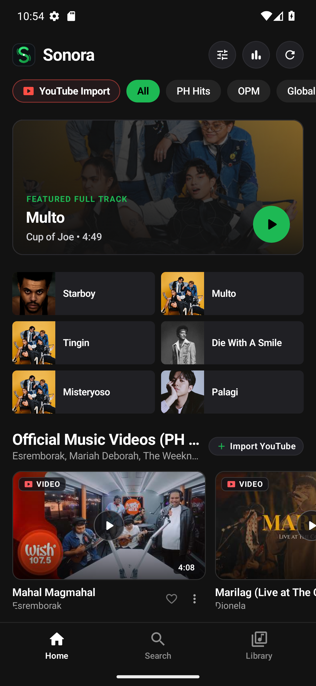
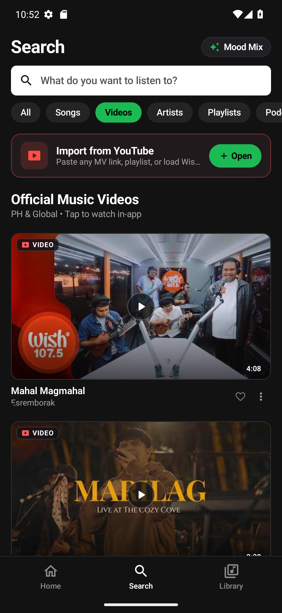
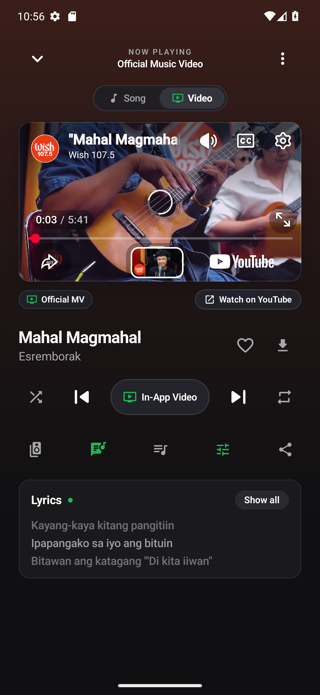
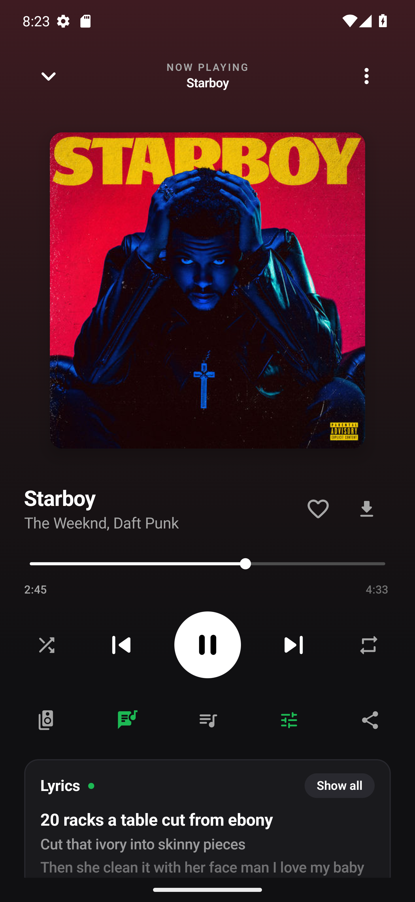

# Sonora

**Sonora** (`com.sonora.music`) is a free, zero-login Android **Spotify + YouTube Music Hybrid** app built with Kotlin, Jetpack Compose, Media3 ExoPlayer, and the official YouTube IFrame Player API in a clean matte charcoal design.

No account, no signup, no ads — stream **100% full-length songs** from start to finish (zero 30-second previews anywhere across `All`, `PH Hits`, `OPM`, `Global`, `Videos`, Search, Playlists, and Downloads), watch official **YouTube Music Videos** in-app with a `[ Song | Video ]` toggle, import YouTube videos/playlists via link or Android Share Sheet, explore **Philippines (PH)** & **Global** hits (strictly filtering out Indian/Bollywood catalog tracks via `RegionalContentFilter`), listen to live PH radio & podcasts, download offline full-length MP3s, follow synced lyrics, and tune audio with a 5-band hardware equalizer.

> **Latest Release APK (`v4.0`)**: [Sonora-v4.0.apk on Google Drive](https://drive.google.com/file/d/1G-TxHc4snHfzw1Zt5H4O6kxYWnPWtPph/view?usp=drivesdk)

---

## App Preview (v4.0)

<table>
  <tr>
    <td align="center"><br /><sub><b>v4.0 Home, Quick Picks &amp; Music Videos</b></sub></td>
    <td align="center"><br /><sub><b>Videos Tab (Esremborak, Dionela &amp; YouTube Import)</b></sub></td>
    <td align="center"><br /><sub><b>Song / Video Switcher &amp; Wish 107.5 MV</b></sub></td>
    <td align="center"><br /><sub><b>Full-Length Audio (Zero 30s Previews)</b></sub></td>
  </tr>
</table>

---

## Key Features (v4.0)

- **Spotify + YouTube Music Hybrid Playback**
  - **`[ Song | Video ]` Segmented Switcher** in `FullPlayerSheet` on hybrid tracks with both full-length audio and a linked official Music Video.
  - **Official YouTube IFrame Player API (`YouTubeVideoPlayer`)** inside hardware-accelerated Android `WebView` configured with explicit origin & `strict-origin-when-cross-origin` referrer policy (no Error 153), fullscreen dialog support, and clean external fallback when rights-holders restrict embedding.
  - **Import from YouTube & Android Share Sheet**: Paste any YouTube URL, video ID, playlist, channel, or `@handle` in-app (with Clipboard Paste + 3 1-tap curated packs: **PH & Wish 107.5 Viral MVs**, **Wish 107.5 Live Bus Feed**, and **Global Pop & R&B Music Videos**), or use Android **Share -> Sonora** directly from the YouTube app.
- **100% Full-Length PH & Global Playback (Zero 30-Second Previews)**
  - **72 Verified Full-Length Audius Seeds (`42` PH/OPM/Viral + `30` Global)** + live resolution — featuring **Mariah Deborah — *Na Para Bang***, **Earl Agustin — *Tibok***, **Amiel Sol — *Sa Bawat Sandali***, **Dilaw — *Uhaw (Tayong Lahat)***, **fitterkarma — *Pag-Ibig ay Kanibalismo II***, **GAT — *Daleng Dale***, Cup of Joe, BINI, Dionela, Maki, TJ Monterde, Over October, Skusta Clee, Hev Abi, alongside **The Weeknd** (`6` originals), Lady Gaga & Bruno Mars, ROSÉ & Bruno Mars, Billie Eilish, HUNTR/X (*Golden*), Kendrick Lamar, SZA, Taylor Swift, Sabrina Carpenter, Olivia Rodrigo, Ariana Grande, JENNIE, Coldplay, and Ed Sheeran.
  - **38 Curated Official Music Videos + 14 Official YouTube Channel RSS Feeds**: Features **Esremborak** (*Mahal Magmahal* on Wish 107.5 Bus, *Tenchu*), **Mariah Deborah** (*Na Para Bang* on Wish 107.5 Bus), BINI, Cup of Joe, Dionela, Maki, Earl Agustin, Shanti Dope, The Weeknd, Bruno Mars, Billie Eilish, Taylor Swift, Ariana Grande, BLACKPINK, Coldplay, Ed Sheeran, Harry Styles, Drake, Lana Del Rey, and Travis Scott.
  - **Strict Anti-Indian Content Filter (`RegionalContentFilter`)**: Excludes Indian/Hindi/Bollywood/Punjabi/Tamil/Telugu/Malayalam/Kannada/Marathi/Bengali/Bhojpuri/Gujarati/Desi tracks, artists, and labels across Audius results, catalog shelves, search, recommendations, and live YouTube RSS drops.
  - **Zero Legacy Previews**: `FullAudioResolver`, `MusicCatalogApi`, `SonoraStore`, `RecommendationEngine`, and `DownloadManager` strip all `isPreviewOnly` and `30s` preview hosts (`cdns-preview`, `cdnt-preview`, `dzcdn.net`, `audio-ssl.itunes`) end-to-end.
  - **Discovery & Media**: **Deezer & Apple Music PH Charts** (discovery/artwork only), **Audius Open Catalog**, **LRCLIB** synced lyrics, **Radio Browser PH**, **iTunes PH Podcasts**, **Internet Archive LibriVox Audiobooks**, and **Device Local Audio (`MediaStore`)**.
- **Playlists, Collaborative Sharing & Offline Downloads**
  - Create, rename, color-theme, reorder, export/import collaborative share codes (`SONORA-PL-V1:` / `sonora://playlist`), merge into a **Jam Queue**, generate prompt-based **Mood Mixes**, and download full-length MP3s for offline listening.
- **Audio Studio & Player Tools**
  - **5-Band Hardware Equalizer**, **Bass Boost**, **Spatial Virtualizer**, **Crossfade** (`0s`–`12s`), **Playback Speed** (`0.75x`–`2.0x`), **Sleep Timer** (`5m`–`60m` or End of Track), **Smart Shuffle**, **Track/Artist Radio**, **Private Session**, and **Wrapped Listening Stats**.

---

## Device Compatibility (Including Samsung Galaxy S21+)

- **Version**: `versionCode = 6`, `versionName = "4.0"`
- **Android Version**: `minSdk = 26` (Android 8.0+) through `targetSdk = 35` (Android 15 / Samsung One UI 3.1 – One UI 7, including One UI themed monochrome icon & hardware-accelerated WebView)
- **CPU ABIs**: `arm64-v8a` (64-bit ARM for Galaxy S21+ Exynos 2100 / Snapdragon 888), `armeabi-v7a`, `x86`, `x86_64`
- **Signing & Display**: APK Signature Scheme v2 release build with edge-to-edge safe insets for punch-hole displays and gesture navigation bars.

---

## Build & Test

Set `JAVA_HOME` (JDK 17+) and `ANDROID_HOME` (or configure `sdk.dir` in `local.properties`):

```powershell
$env:JAVA_HOME = "D:\Android Studio\jbr"
$env:ANDROID_HOME = "$env:LOCALAPPDATA\Android\Sdk"

# Run JVM unit tests (DataLayerTest 15 tests + PlayerLogicTest 12 tests)
.\gradlew.bat :app:testDebugUnitTest

# Build release APK
.\gradlew.bat :app:assembleRelease
```

> **Note:** Release signing in `app/build.gradle.kts` reads an optional local `keystore.properties` (falling back to debug signing when absent). Keystores, `keystore.properties`, and built `.apk` files are excluded from version control via `.gitignore`.

---

Made by Jeremiah Temporado
