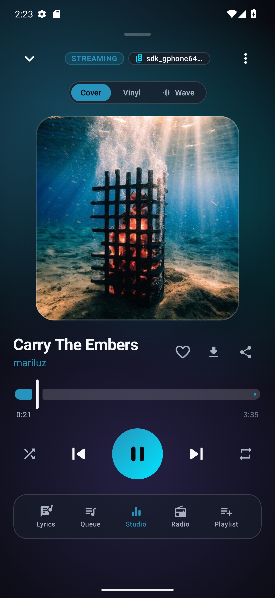
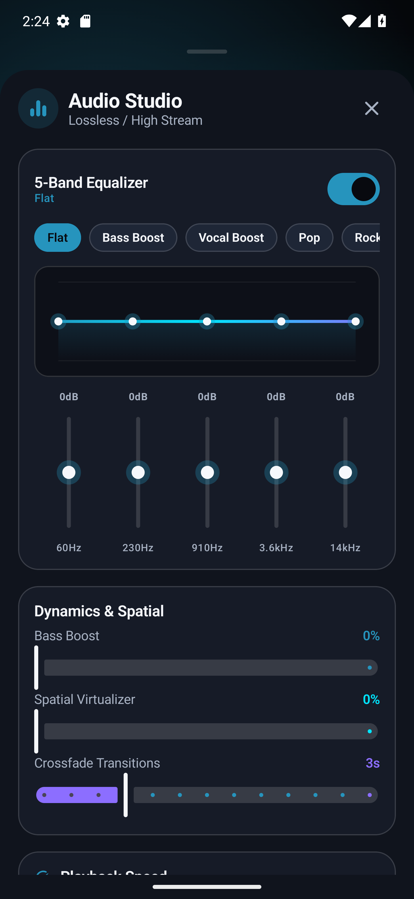

# Sonora

**Sonora** (`com.sonora.music`) is a free, zero-login Android music streaming and offline audio player built with Kotlin, Jetpack Compose, and Media3 ExoPlayer in an Obsidian OLED design with dynamic album-art theming and kinetic animations.

No account, no signup, no ads, and all playback/customization features are unlocked automatically out of the box.

---

## App Preview

<table>
  <tr>
    <td align="center"><br /><sub><b>Personalized Home &amp; Dynamic Theme</b></sub></td>
    <td align="center"><br /><sub><b>Ambient Full Player &amp; Controls</b></sub></td>
    <td align="center"><br /><sub><b>Audio Studio &amp; 5-Band Equalizer</b></sub></td>
  </tr>
</table>

---

## Key Features

- **Zero-Login Instant Streaming**
  - Open the app and immediately browse, search, and stream full-length independent tracks without signing in or paying for a subscription.
  - Powered by open, no-auth catalogs: **Audius** (music tracks, playlists, artists, genre charts), **LRCLIB** (synced karaoke & plain lyrics), **iTunes + RSS** (podcasts), **Internet Archive LibriVox** (free classic audiobooks), **Radio Browser** (live global radio), plus **Device Local Files** via `MediaStore`.
- **Personalized Discovery & Recommendations**
  - Dynamic **Quick Picks**, **Made For You** (**Discover Weekly**, **Release Radar**, **Daily Mix**), **Mood & Genre Filters**, and **Recently Played**.
  - **Sonora Wrapped**: Animated 5-slide story summary showing listening minutes, top tracks, top artists, top genres, sound aura gradient, and listener persona.
- **Playlists, Collaborative Sharing & AI Mood Generator**
  - Create, rename, color-theme, reorder, edit, and share playlists locally with embedded track metadata.
  - **Collaborative Share / Jam Codes** (`SONORA-PL-V1:` base64 codes & `sonora://playlist` deep links) to share playlists or merge into a shared **Jam Queue**.
  - **AI Mood Playlist Studio**: Describe any mood or activity (e.g., *"Late Night Drive"*, *"Lo-Fi Study"*, *"Gym Phonk"*) to generate a multi-track playlist in seconds.
- **Offline Downloads & Device Local Files**
  - Download any streamable track or entire playlist as local `.mp3` files with live progress tracking and offline-first playback when disconnected.
  - Scan and play audio files already stored on your phone (`READ_MEDIA_AUDIO` / `READ_EXTERNAL_STORAGE`).
- **Immersive Player & Audio Studio**
  - **Three Visual Modes**: Interactive 3D touch-tilt **Cover**, rotating **Spinning Vinyl** with animated tonearm, and harmonic **Live Soundwave** (`SoundwaveCanvas`).
  - **Synced Karaoke Lyrics**: Auto-scrolling timestamped lyrics with tap-to-seek (`LRCLIB`).
  - **Smart Shuffle & Radio**: 3-state shuffle (`Off`, `Shuffle`, `Smart Shuffle`) weaving recommended tracks into the queue, plus **Track Radio** & **Artist Radio**.
  - **5-Band Hardware Equalizer, Bass Boost & Virtualizer**: Interactive Bezier frequency curve, 9 presets, custom faders (`60Hz`–`14kHz`), **Crossfade** (`0s`–`12s`), **Playback Speed** (`0.75x`–`2.0x`), **Sleep Timer** (`5m`–`60m` or End of Track), **Private Session**, and **Audio Output Switcher**.

---

## Device Compatibility (Including Samsung Galaxy S21+)

- **Android Version**: `minSdk = 26` (Android 8.0+) through `targetSdk = 35` (Android 15 / Samsung One UI 3.1 – One UI 7)
- **CPU ABIs**: `arm64-v8a` (64-bit ARM for Galaxy S21+ Exynos 2100 / Snapdragon 888), `armeabi-v7a`, `x86`, `x86_64`
- **Signing & Display**: APK Signature Scheme v2 release build with edge-to-edge safe insets (`statusBarsPadding` / `navigationBarsPadding`) for punch-hole displays and gesture navigation bars.

---

## Build & Test

Set `JAVA_HOME` (JDK 17+) and `ANDROID_HOME` (or configure `sdk.dir` in `local.properties`):

```powershell
$env:JAVA_HOME = "D:\Android Studio\jbr"
$env:ANDROID_HOME = "$env:LOCALAPPDATA\Android\Sdk"

# Run JVM unit tests (DataLayerTest + PlayerLogicTest)
.\gradlew.bat :app:testDebugUnitTest

# Build release APK
.\gradlew.bat :app:assembleRelease
```

> **Note:** Release signing in `app/build.gradle.kts` reads an optional local `keystore.properties` (falling back to debug signing when absent). Keystores, `keystore.properties`, and built `.apk` files are excluded from version control via `.gitignore`.

---

Made by Jeremiah Temporado
