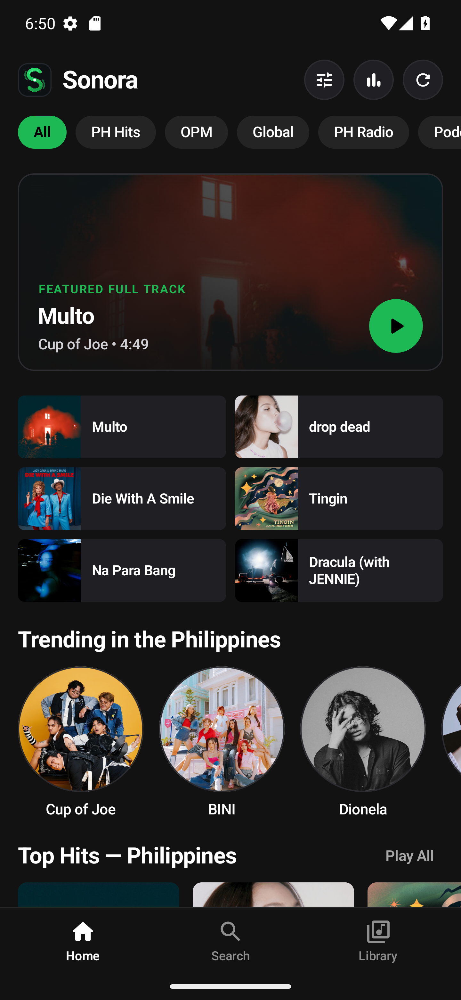

# Sonora

**Sonora** (`com.sonora.music`) is a free, zero-login Android music streaming and offline audio player built with Kotlin, Jetpack Compose, and Media3 ExoPlayer in a clean matte charcoal design.

No account, no signup, no ads — stream **100% full-length songs** from start to finish (zero 30-second previews), explore real **Philippines (PH)** & **Global** hits, listen to live PH radio & podcasts, download offline full-length MP3s, follow synced lyrics, and tune audio with a 5-band hardware equalizer.

---

## App Preview (v3.1)

<table>
  <tr>
    <td align="center"><br /><sub><b>Sonora Logo, Editorial Hero &amp; PH Home</b></sub></td>
    <td align="center"><br /><sub><b>Full-Length OPM + Synced Lyrics</b></sub></td>
    <td align="center"><br /><sub><b>The Weeknd · Starboy (2:45 / 4:33)</b></sub></td>
    <td align="center"><br /><sub><b>Search, Mood Mix &amp; Mini Player</b></sub></td>
  </tr>
</table>

---

## Key Features (v3.1)

- **100% Full-Length PH & Global Playback (Zero 30-Second Previews)**
  - Every playable music track streams and downloads as a complete full-length track (`>= 90s` verified `audio/*` stream, zero 30s Deezer/iTunes preview clips anywhere in playback, queues, or offline cache).
  - **46 Curated Full-Length Seed Tracks + Live Chart Resolution**: `17` trending PH/OPM tracks (Cup of Joe, BINI, Dionela, TJ Monterde, Arthur Nery, Maki, SunKissed Lola, Adie, Hev Abi, Lola Amour, Moira Dela Torre) and `29` curated Global hits — including `6` genuine full-length **The Weeknd** originals (*Starboy*, *Call Out My Name*, *The Hills*, *Often*, *I Feel It Coming*, *Wicked Games*) alongside Lady Gaga & Bruno Mars, Billie Eilish, Taylor Swift, Kendrick Lamar, Olivia Rodrigo, Ariana Grande, SZA, Sabrina Carpenter, JENNIE, Coldplay, Ed Sheeran, and Travis Scott.
  - `FullAudioResolver` searches expanded Audius candidates, strips leading articles (e.g., `The Weeknd`), filters cover/noise uploads via title and description scoring, prefers official Deezer/iTunes studio album artwork in `MusicCatalogApi`, and automatically purges any legacy 30-second cached `.mp3` files (`< 700 KB` or stripped legacy preview metadata) on app upgrade.
  - **Discovery & Media**: **Deezer & Apple Music PH Charts** (discovery/artwork only), **Audius Open Catalog** (full-length audio), **LRCLIB** live synced lyrics + inline lyrics card, **Radio Browser PH** (`96.3 Easy Rock`, `Star FM Manila`, `Love Radio`, `WRocK`, `DZRH`), **iTunes PH Podcasts**, **Internet Archive LibriVox Audiobooks**, and **Device Local Audio (`MediaStore`)**.
- **Professional Brand Icon & Polished UI/UX**
  - Custom sculpted geometric **Sonora "S" Acoustic Ribbon** vector logo across splash, in-app header (`SonoraBrandLogo`), and Android adaptive + Samsung One UI `<monochrome>` launcher icons.
  - Clean matte charcoal (`#121212`) palette with Editorial Spotlight Hero Card, unclipped filter chips, breathing spring-scaled Now Playing artwork, tabular-num seek bar, and inline synced lyrics preview card.
- **Playlists, Collaborative Sharing & Offline Downloads**
  - Create, rename, color-theme, reorder, export/import collaborative share codes (`SONORA-PL-V1:` / `sonora://playlist`), merge into a **Jam Queue**, generate prompt-based **Mood Mixes**, and download full-length MP3s for offline listening.
- **Audio Studio & Player Tools**
  - **5-Band Hardware Equalizer**, **Bass Boost**, **Spatial Virtualizer**, **Crossfade** (`0s`–`12s`), **Playback Speed** (`0.75x`–`2.0x`), **Sleep Timer** (`5m`–`60m` or End of Track), **Smart Shuffle**, **Track/Artist Radio**, **Private Session**, and **Wrapped Listening Stats**.

---

## Device Compatibility (Including Samsung Galaxy S21+)

- **Version**: `versionCode = 5`, `versionName = "3.1"`
- **Android Version**: `minSdk = 26` (Android 8.0+) through `targetSdk = 35` (Android 15 / Samsung One UI 3.1 – One UI 7, including One UI themed monochrome icon)
- **CPU ABIs**: `arm64-v8a` (64-bit ARM for Galaxy S21+ Exynos 2100 / Snapdragon 888), `armeabi-v7a`, `x86`, `x86_64`
- **Signing & Display**: APK Signature Scheme v2 release build with edge-to-edge safe insets for punch-hole displays and gesture navigation bars.

---

## Build & Test

Set `JAVA_HOME` (JDK 17+) and `ANDROID_HOME` (or configure `sdk.dir` in `local.properties`):

```powershell
$env:JAVA_HOME = "D:\Android Studio\jbr"
$env:ANDROID_HOME = "$env:LOCALAPPDATA\Android\Sdk"

# Run JVM unit tests (DataLayerTest + PlayerLogicTest)
.\gradlew.bat :app:testDebugUnitTest

# Build release APK
.\gradlew.bat :app:assembleRelease
```

> **Note:** Release signing in `app/build.gradle.kts` reads an optional local `keystore.properties` (falling back to debug signing when absent). Keystores, `keystore.properties`, and built `.apk` files are excluded from version control via `.gitignore`.

---

Made by Jeremiah Temporado
