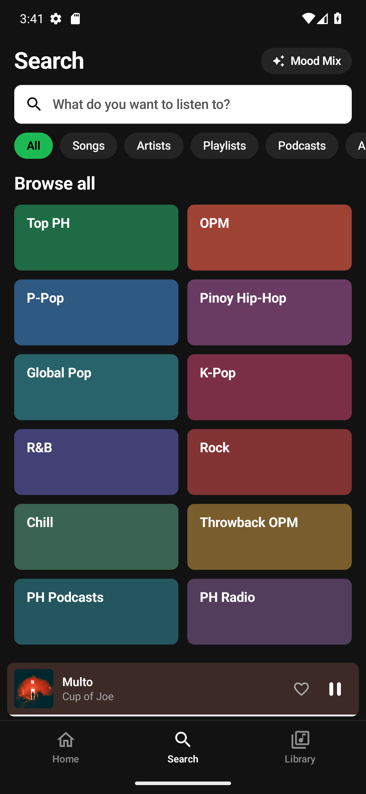

# Sonora

**Sonora** (`com.sonora.music`) is a free, zero-login Android music streaming and offline audio player built with Kotlin, Jetpack Compose, and Media3 ExoPlayer in a clean matte charcoal design.

No account, no signup, no ads — launch straight into real **Philippines (PH)** & **Global** charts, trending OPM/P-Pop & international artists, PH live radio, podcasts, playlists, synced lyrics, and a 5-band hardware equalizer.

---

## App Preview (v2.0)

<table>
  <tr>
    <td align="center"><br /><sub><b>PH &amp; Global Home + Docked Mini Player</b></sub></td>
    <td align="center"><br /><sub><b>Calm Matte Now Playing Screen</b></sub></td>
    <td align="center"><br /><sub><b>Search &amp; PH/Global Categories</b></sub></td>
  </tr>
</table>

---

## Key Features (v2.0)

- **Real Philippines & Global Trending Charts & Artists**
  - **Trending in the Philippines**: Cup of Joe, BINI, Dionela, TJ Monterde, Arthur Nery, Maki, SB19, Ben&Ben, IV Of Spades, Hev Abi, Lola Amour, Moira Dela Torre, Zack Tabudlo, juan karlos, Skusta Clee, Rob Deniel, SunKissed Lola, Adie.
  - **Global Trending Artists & Charts**: Taylor Swift, Bruno Mars, Ariana Grande, Olivia Rodrigo, The Weeknd, Sabrina Carpenter, Billie Eilish, Lady Gaga, JENNIE, Kendrick Lamar, Tate McRae.
  - Live feeds powered by **Deezer Charts & Playlists** (`Top Hits Philippines`, `OPM Viral`, `Global Top 50`, `Throwback OPM`), **Apple Music PH Charts**, **iTunes PH**, **LRCLIB** synced lyrics, **Radio Browser PH** (`96.3 Easy Rock`, `Star FM Manila`, `Love Radio`, `WRocK`, `DZRH`), **iTunes PH Podcasts**, **Internet Archive LibriVox Audiobooks**, and **Device Local Audio (`MediaStore`)**.
  - Automatic stream preview refresh before playback/download plus 1-tap **Open Full Song** shortcut alongside full-length live PH radio, podcasts, audiobooks, and device audio files.
- **Playlists, Collaborative Sharing & Mood Mixes**
  - Create, rename, color-theme, reorder, export/import collaborative share codes (`SONORA-PL-V1:` / `sonora://playlist`), merge into a **Jam Queue**, and generate prompt-based **Mood Mixes**.
- **Offline Downloads & Device Local Files**
  - Save tracks or entire playlists as offline audio files with live progress tracking and offline-first playback.
  - Scan and play audio files stored on your phone (`READ_MEDIA_AUDIO` / `READ_EXTERNAL_STORAGE`).
- **Audio Studio & Player Tools**
  - **5-Band Hardware Equalizer**, **Bass Boost**, **Spatial Virtualizer**, **Crossfade** (`0s`–`12s`), **Playback Speed** (`0.75x`–`2.0x`), **Sleep Timer** (`5m`–`60m` or End of Track), **Smart Shuffle**, **Track/Artist Radio**, **Private Session**, **Listening Stats (Wrapped)**, and **Synced Lyrics**.

---

## Device Compatibility (Including Samsung Galaxy S21+)

- **Android Version**: `minSdk = 26` (Android 8.0+) through `targetSdk = 35` (Android 15 / Samsung One UI 3.1 – One UI 7)
- **CPU ABIs**: `arm64-v8a` (64-bit ARM for Galaxy S21+ Exynos 2100 / Snapdragon 888), `armeabi-v7a`, `x86`, `x86_64`
- **Signing & Display**: APK Signature Scheme v2 release build with edge-to-edge safe insets for punch-hole displays and gesture navigation bars.

---

## Build & Test

Set `JAVA_HOME` (JDK 17+) and `ANDROID_HOME` (or configure `sdk.dir` in `local.properties`):

```powershell
$env:JAVA_HOME = "D:\Android Studio\jbr"
$env:ANDROID_HOME = "$env:LOCALAPPDATA\Android\Sdk"

# Run JVM unit tests (DataLayerTest + PlayerLogicTest)
.\gradlew.bat :app:testDebugUnitTest

# Build release APK
.\gradlew.bat :app:assembleRelease
```

> **Note:** Release signing in `app/build.gradle.kts` reads an optional local `keystore.properties` (falling back to debug signing when absent). Keystores, `keystore.properties`, and built `.apk` files are excluded from version control via `.gitignore`.

---

Made by Jeremiah Temporado
